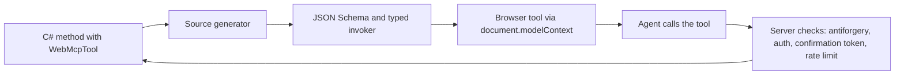

<!-- readme:header:start -->
<p>
  
  <a href="https://github.com/Egoushka/handrail/actions/workflows/ci.yml"></a>
  
</p>
<!-- readme:header:end -->

# Handrail

> Turns C# methods into WebMCP tools for ASP.NET Core, with the JSON Schema and the server-side safety checks generated from one attribute.

<!-- readme:status:start -->
**Parked**. It works; I am not changing it now and may come back.
<!-- readme:status:end -->



A safe guide for agents on your page: one attribute is the source of truth for the browser tool, its JSON Schema, and
the server-side checks that guard it. This is preview `0.1.0-preview.1`. WebMCP is a draft (Community Group report, 10 Nov
2026) and Chrome support is early preview, so the browser runtime is one small file that follows the spec.

## Quick start

```
dotnet add package Handrail.AspNetCore --prerelease
```

`Handrail.AspNetCore` brings `Handrail` (the attribute, source generator and analyzers) with it. Targets net8.0 and
net10.0.

## Use

```csharp
public class NotesTools(INoteStore notes)
{
    /// <summary>Search the user's notes by text. Use before get_note.</summary>
    [WebMcpTool("search_notes", ReadOnly = true, ReturnsUntrusted = true)]
    public IReadOnlyList<NoteSummary> Search(
        [Description("Words to look for")] string query,
        [Range(1, 20)] int limit = 5) => notes.Search(query, limit);

    /// <summary>Permanently delete a note.</summary>
    [WebMcpTool("delete_note", Consequential = true, Confirm = Confirm.Page)]
    public bool Delete(Guid id) => notes.Delete(id);
}
```

```csharp
builder.Services.AddWebMcp();
builder.Services.AddWebMcpTools<NotesTools>();
app.MapWebMcp();            // POST /_webmcp/invoke/{tool}, POST /_webmcp/confirm/{tool}, GET /_webmcp/runtime.js
```

```html
@addTagHelper *, Handrail.AspNetCore
<webmcp-tools />            <!-- in the layout: data block + the runtime module -->
```

The generator reads the method signature, `[Description]`, `[Range]`, `[StringLength]`, `[Required]` and the XML
summary, and emits the JSON Schema and a typed invoker at build time. There is no reflection over tool methods at
runtime and the server validates every call against the same schema.

## Safe by default

- A write needs `Consequential = true` and an explicit `Confirm`, or the build fails (WM0001).
- `Confirm.Page` shows a modal dialog that only a trusted click can allow, and the server refuses the call without a
  one-time token minted after that click. A script that calls the endpoint directly gets 403.
- Antiforgery, `[Authorize]` policies, a signed-in user for writes, a per-user rate limit, JSON-only requests and
  `Sec-Fetch-Site` checks sit in front of every call.

Details and limits (XSS is out of scope): [docs/security.md](docs/security.md). Diagnostics and their mapping to
Levelset checks: [docs/analyzers.md](docs/analyzers.md). A runnable app: [samples/NotesApp](samples/NotesApp).

## Packages

| Package | Contents |
|---|---|
| `Handrail` | `[WebMcpTool]`, descriptor model, confirmation tokens, source generator, analyzers |
| `Handrail.AspNetCore` | endpoints, `<webmcp-tools>` and form tag helpers, JavaScript runtime |

## Paying per call

An agent can pay for a WebMCP tool with x402 and no human in the loop: the page calls its paid endpoint, gets a 402,
the agent host signs a capped payment, and the tool returns. The measured flow (Chromium with native WebMCP, local
chain and test token, 25 runs per scenario) is in
[x402-webmcp-lab](https://github.com/Egoushka/x402-webmcp-lab): about 262 ms median from tool call to result on
200 ms blocks. That lab is plain JavaScript; a `[PaidTool]` attribute that does the same from a C# method is planned.

Not yet: Blazor components, an MCP bridge (`[McpExpose]`), a paid-tool bridge (`[PaidTool]` via x402-mcp-dotnet),
minimal-API `WithWebMcpTool`, a testing package.

## Docs

- [docs/security.md](docs/security.md): the security model and its limits
- [docs/analyzers.md](docs/analyzers.md): diagnostics
- [docs/releasing.md](docs/releasing.md): how a tag becomes a NuGet release
- [CHANGELOG.md](CHANGELOG.md)

Licence: MIT.

<!-- readme:footer:start -->
---

<sub>Made by [Yehor Hrabovskyi](https://hrabovskyi.online) · [MIT licence](LICENSE).</sub>
<!-- readme:footer:end -->
